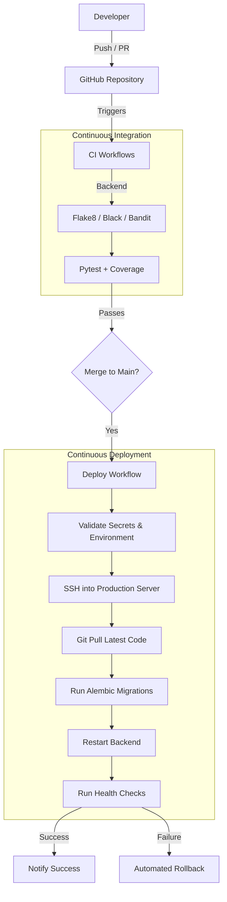

# CapitalEdge AI - CI/CD Documentation

This document outlines the Continuous Integration and Continuous Deployment (CI/CD) pipelines implemented for the CapitalEdge AI project using **GitHub Actions**. The pipeline is modular, future-proof, and designed to deploy securely once a production environment is established.

## 1. Pipeline Architecture

The CI/CD pipeline consists of three primary workflows and one dependency management configuration:

1. **Backend CI (`backend-ci.yml`)**: Lints, validates security, and tests the FastAPI backend.
2. **Continuous Deployment (`deploy.yml`)**: Automates the rollout of validated code to a production environment.
3. **Release Manager (`release.yml`)**: Automates GitHub Releases and artifact generation on version tags (`v*.*.*`).
4. **Dependabot (`dependabot.yml`)**: Automatically scans and opens PRs for outdated `pip` packages and GitHub Actions.

### CI/CD Flow Diagram



## 2. Trigger Conditions

- **Pull Requests**: Pushing to any PR targeting `main` or `develop` triggers the backend CI pipeline. Merge is blocked if the job fails.
- **Push to Main**: Merging code into `main` triggers the CI workflows, followed by the **Deployment workflow**.
- **Push to Tags**: Pushing a tag like `v1.0.0` triggers the **Release workflow**.
- **Manual Dispatch**: All workflows can be triggered manually via the GitHub Actions UI.

## 3. Required GitHub Secrets

To enable the deployment pipeline, you must define the following secrets in your GitHub Repository (`Settings > Secrets and variables > Actions`):

| Secret Name | Description |
|---|---|
| `SSH_HOST` | IP address or domain of the production server (e.g., EC2, DigitalOcean). |
| `SSH_USER` | SSH username (e.g., `ubuntu` or `root`). |
| `SSH_PRIVATE_KEY` | The private PEM key used to authenticate with the server. |
| `DATABASE_URL` | Production PostgreSQL connection string. |
| `JWT_SECRET` | Production secret for signing JWTs (`AUTH_TOKEN`). |
| `SLACK_WEBHOOK_URL` | (Optional) Webhook URL for deployment notifications. |

*Note: Add any specific application keys (like `OPENAI_API_KEY`) directly to the `.env` file on the production server, or pass them through GitHub Secrets if deploying via Docker.*

## 4. Deployment Flow (Future-Proofing)

Currently, the deployment workflow (`deploy.yml`) is staged with **placeholders**. When a server becomes available, the pipeline will perform the following:

1. **Connect**: SSH into the host using `SSH_PRIVATE_KEY`.
2. **Pull**: Retrieve the latest code from the `main` branch.
3. **Backend Update**: Activate the Python virtual environment, install dependencies (`pip install -r requirements.txt`), and apply database migrations (`alembic upgrade head`).
4. **Restart Services**: Restart the `systemctl` service (e.g., Gunicorn).
5. **Health Check**: Ping the `/api/v1/health` or `/` endpoint to ensure the server is alive.

### Rollback Strategy

```mermaid
graph TD
    Fail[Health Check Failed] --> SSH[SSH into Server]
    SSH --> Reset[git reset --hard HEAD@{1}]
    Reset --> Revert[Revert Dependencies]
    Revert --> Restart[Restart Services]
    Restart --> Notify[Notify Slack of Failure]
```

If the health check fails, the pipeline automatically executes a rollback sequence that resets the git repository to the previous commit state, reinstalls the previous dependencies, and restarts the services.

## 5. How to Enable Production Deployment

Once infrastructure is provisioned:

1. Add the SSH credentials and `DATABASE_URL` to GitHub Secrets.
2. Open `.github/workflows/deploy.yml`.
3. Locate the `Deploy to Server (Placeholder)` step.
4. Uncomment the `ssh` command block.
5. Update the path (`/var/www/agentic-ai`) to match your server's deployment directory.
6. Push the changes to `main`.

## 6. Docker Support (Optional)

If you migrate to containerized deployments (Kubernetes, AWS ECS, or Docker Swarm), use the provided `Dockerfile.backend` and `docker-compose.example.yml`. 

To deploy via Docker, simply modify the `deploy.yml` script to run:
```bash
docker-compose pull
docker-compose up -d --build
```
This isolates the environment and eliminates the need to run `pip` directly on the host machine.
