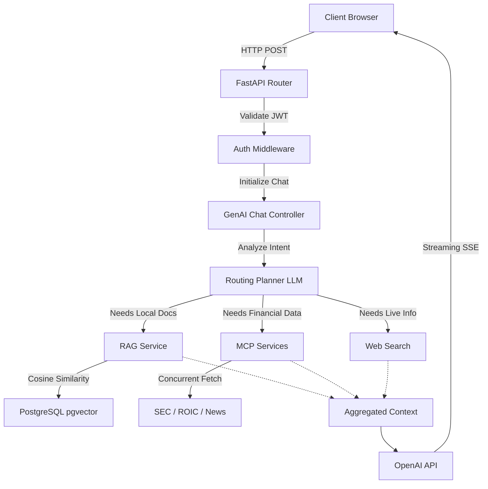

# CapitalEdge AI Enterprise Backend

CapitalEdge AI Enterprise is an AI-powered Conversational Intelligence and Market Research platform. The backend is a high-performance, asynchronous REST API built with **FastAPI** that powers intelligent document processing, dynamic workspace management, Retrieval-Augmented Generation (RAG), and Model Context Protocol (MCP) integrations with external financial data providers.

## 1. Project Overview

**Purpose**: To provide a robust, enterprise-grade backend for parsing and embedding complex market research documents, orchestrating intelligent chat workflows, and streaming AI-generated insights back to the client.

**Core Features**:
- **Workspaces & Document Management**: Segregated workspaces for organizing documents (PDFs, DOCX, CSVs, Images).
- **Advanced Document Pipeline**: Asynchronous hybrid OCR pipeline (Native text + Computer Vision) with parallel chunking and embedding.
- **RAG & Vector Search**: High-dimensional vector search using PostgreSQL `pgvector`.
- **Intelligent Routing Planner**: Automatically classifies user intent to route queries between local RAG, external MCPs, or Live Web Search.
- **MCP Services**: Direct integrations with SEC EDGAR, ROIC AI, Companies House, and Financial News APIs.
- **SSE Streaming**: Server-Sent Events for real-time LLM token streaming to the client frontend.

---

## 2. Technology Stack

- **Core Framework**: Python 3.14, FastAPI, Uvicorn (ASGI server)
- **Database**: PostgreSQL, `pgvector` (Vector similarity search)
- **ORM & Migrations**: SQLAlchemy (Async support), Alembic
- **Authentication**: JWT (JSON Web Tokens), Google OAuth 2.0, Passlib (`bcrypt`), python-jose
- **AI & Embeddings**: OpenAI API (GPT-4o, o3-mini, text-embedding-3-small)
- **Document Processing**: PyMuPDF (`fitz`), python-docx, pandas, openpyxl
- **OCR Engine**: `rapidocr-onnxruntime`, `pytesseract`, `easyocr`, OpenCV (`cv2`)
- **Web Search**: SerpAPI
- **Testing**: Pytest, `pytest-cov`, `pytest-html`
- **Linting & Formatting**: `flake8`, `pre-commit`

---

## 3. Backend Folder Structure

```text
.
├── alembic/                # Database migration scripts and environment
├── alembic.ini             # Alembic configuration
├── main.py                 # Application entry point for Uvicorn
├── requirements.txt        # Python dependencies
├── server/
│   ├── api.py              # API Router aggregator (combines all v1 routers)
│   ├── api_v1/             # API version 1 module
│   │   └── endpoints/      # Controller layer (FastAPI routers)
│   ├── config/             # Environment variables and application settings
│   ├── crud/               # Data Access Layer (Create, Read, Update, Delete)
│   ├── db/                 # Database connection and session management
│   ├── models/             # SQLAlchemy ORM database models
│   ├── schemas/            # Pydantic models for Request/Response validation
│   └── services/           # Business logic, RAG, MCP, and Document pipelines
└── tests/                  # Pytest automated test suites
```

**Directory Responsibilities**:
- **`models/`**: Defines the database schema (SQLAlchemy Base classes).
- **`schemas/`**: Defines the data contracts for APIs (Pydantic).
- **`crud/`**: Houses all direct database interactions. Controllers must call CRUD methods, not query the DB directly.
- **`services/`**: Holds core business logic. Separation of concerns is heavily enforced here (e.g., `ocr_service.py` only handles text extraction, `embedding_service.py` only handles vectors).

---

## 4. Backend Architecture

The backend architecture follows a highly concurrent, service-oriented pattern.



---

## 5. Complete Backend Workflow

### RAG & Document Ingestion Workflow
When a user uploads a document to a workspace, the `document_processor.py` orchestrates the following:
1. **Extraction**: `ocr_service.py` evaluates the file. PDFs are processed in a 2-phase hybrid approach where the native text layer is extracted, and pages with images are rendered and sent to a highly parallelized `ThreadPoolExecutor` for OCR via OpenCV/RapidOCR.
2. **Chunking**: `chunking_service.py` splits the text into overlapping chunks with citation metadata (page numbers, offsets).
3. **Embedding**: `embedding_service.py` utilizes `asyncio.gather` to concurrently fire multiple batches of text chunks to OpenAI's embeddings API, generating 1536-dimensional vectors.
4. **Storage**: The chunks and vectors are batch-inserted into PostgreSQL via `crud.document_chunk`.

### Chat & Routing Workflow
When a user submits a prompt, `genai.py` initiates the chat sequence:
1. **Validation**: Validates the JWT and fetches the chat session.
2. **Planning**: A lightweight LLM classification phase runs concurrently to determine:
   - Does this query require workspace documents?
   - Does this query require specific MCP integrations (e.g., SEC EDGAR)?
   - What is the primary intent?
3. **Retrieval**: Depending on the planner's output, `rag_service.py` retrieves vector-matched document chunks from `pgvector` and/or dispatches concurrent requests to MCP services using a `ThreadPoolExecutor`.
4. **Generation**: The context is aggregated, prompt templates are applied, and an SSE generator streams the LLM's response back to the client token-by-token.

---

## 6. Project Setup

### Prerequisites
- Python 3.10 or higher
- PostgreSQL 15+ (with the `pgvector` extension installed and enabled)
- Git

### Clone Repository
```bash
git clone <repository-url>
cd <project-name>
```

### Create Virtual Environment
```bash
# Create the environment
python -m venv venv

# Activate on Linux/macOS
source venv/bin/activate

# Activate on Windows
venv\Scripts\activate
```

### Install Dependencies
```bash
pip install -r requirements.txt
```

### Configure Environment Variables
Copy the template to create your `.env` file:
```bash
cp .env.example .env
```
Key configurations include:
- `SQLALCHEMY_DATABASE_URI`: Your PostgreSQL connection string. Must include `postgresql+psycopg2`.
- `OPENAI_API_KEY`: API key for LLM generation and embeddings.
- `AUTH_TOKEN`: Secret key for signing JWTs.
- `MAIL_USERNAME` / `MAIL_PASSWORD`: SMTP credentials for OTP and verification emails.

---

## 7. Database Setup

Ensure your PostgreSQL instance is running and you have created a database (e.g., `CapitalEdge`). You must manually install the `pgvector` extension on your PostgreSQL server if you haven't already.

Run Alembic migrations to build the tables and create the `vector` extension inside the DB:
```bash
# Apply all migrations to the latest version
alembic upgrade head
```
*Note: If you modify the models in `server/models/`, generate a new migration using `alembic revision --autogenerate -m "description"`.*

---

## 8. Running the Backend Locally

Start the FastAPI server via Uvicorn:
```bash
uvicorn server.main:app --reload --host 127.0.0.1 --port 8000
```
Alternatively, run the entry point script:
```bash
python main.py
```

**Local Endpoints:**
- **Base URL**: `http://127.0.0.1:8000`
- **Swagger UI**: `http://127.0.0.1:8000/docs` (Interactive API documentation)
- **ReDoc UI**: `http://127.0.0.1:8000/redoc`
- **Health Check**: `GET /`

---

## 9. API Documentation

The backend is modularized under the `/v1` prefix. Detailed interactive documentation is available at `/docs` when the server is running.

### Users (`/v1/user`)
- `POST /login`: Authenticate and receive JWT.
- `POST /google-login`: Authenticate via Google OAuth 2.0.
- `POST /signup`: Register a new user.
- `POST /verify-otp`: Verify email via OTP.
- `POST /profile`: Fetch the current user's profile.
- `POST /update-profile`: Update user details.
- `POST /forgot-password-send-otp`: Initiate password reset.

### Workspace (`/v1/workspace`)
- `POST /create-workspace`: Create a new organizational workspace.
- `GET /list-workspaces`: Fetch user's workspaces.
- `GET /{workspace_id}`: Fetch workspace details.
- `POST /upload-docs`: Ingest documents, extract text, chunk, and embed.
- `GET /{workspace_id}/docs`: List all documents in a workspace.
- `DELETE /{workspace_id}/docs/{doc_id}`: Delete a document and its embeddings.

### GenAI (`/v1/ai`)
- `POST /chats`: Create a new chat session.
- `GET /chats`: List all chat sessions.
- `GET /chats/{chat_id}`: Fetch chat history.
- `POST /chats/{chat_id}/messages`: Submit a prompt and receive a streaming SSE response.

### Documents & Citations (`/v1/documents` & `/v1/citations`)
- `GET /documents/{document_id}/viewer`: Fetch file paths for viewing.
- `GET /documents/{document_id}/highlight`: Fetch exact text boundaries for frontend highlighting.
- `POST /documents/export-pdf`: Export generated reports to PDF.
- `GET /citations/roic/transcript/{ticker}`: Fallback to fetch raw ROIC transcripts.

---

## 10. Authentication

The platform utilizes **JWT (JSON Web Tokens)** for stateless authentication.
1. **Signup**: Users register and receive an OTP via SMTP. Passwords are hashed using `bcrypt` before database insertion.
2. **Login**: Exchanges email/password for an access token.
3. **Authorization**: Protected routes use `Depends(get_current_user)` which extracts the JWT from the `Authorization: Bearer <token>` header, decodes it using `python-jose` and the `AUTH_TOKEN` secret, and attaches the active `User` model to the request state.

---

## 11. Database Design

**Core Tables & Relationships**:
- **`users`**: User accounts and RBAC roles.
- **`workspaces`**: Logical containers owned by a user (`user_id` FK).
- **`documents`**: Files uploaded to a workspace (`workspace_id` FK).
- **`document_chunks`**: The foundational RAG table. Belongs to `documents`. Contains the `content` and the `embedding` (a `VECTOR(1536)` column). Indexed using an HNSW index for `vector_cosine_ops` to enable rapid semantic search.
- **`chat_sessions`**: Conversations linked to a workspace.
- **`chat_messages`**: Individual messages (User or AI) containing arrays of cited `document_ids`.
- **`document_chat_links`**: A junction table strictly associating documents with the chats that referenced them.

---

## 12. MCP Services (Model Context Protocol)

The backend features dedicated Model Context Protocol implementations to fetch live, structured data when the LLM planner identifies a financial intent.

- **`SEC EDGAR`**: Fetches real-time 10-K, 10-Q, and company facts.
- **`ROIC AI`**: Retrieves historical financial metrics, ratios, and earnings call transcripts.
- **`Companies House`**: Retrieves UK corporate registry data and officer histories.
- **`Financial News`**: Aggregates recent market news dynamically.

These services run concurrently via `ThreadPoolExecutor` and cache results aggressively in memory to prevent rate limits and reduce latency.

---

## 13. Testing

The project utilizes `pytest` for automated unit and integration testing.

**Running the Test Suite**:
```bash
# Run all tests
pytest

# Run tests with HTML coverage report
pytest --cov=server --cov-report=html

# Run module-specific tests
pytest tests/users/
pytest tests/genai/
pytest tests/documents/
```
The test suite spans authentication, GenAI routing, document processing (with mocked OCR/Embeddings), and workspace management.

---

## 14. Error Handling & Logging

- **Global Exceptions**: A centralized exception handler in `main.py` intercepts `StarletteHTTPException`, `RequestValidationError`, and generic `Exception`s, returning a standardized JSON structure (`{ success: false, error: "..." }`).
- **Audit Logging**: A dedicated `AuditLogger` (`audit_logger.py`) records system actions (Logins, OCR processing times, API failures) for debugging and compliance.
- **Logging**: Standard Python `logging` is configured for detailed module-level telemetry (e.g., tracking chunk generation counts, LLM execution times).

---

## 15. Performance Optimizations

- **Parallel Planner**: GenAI routing queries execute concurrently via `ThreadPoolExecutor`, reducing Time-To-First-Token by ~40%.
- **Concurrent Embeddings**: The ingestion pipeline utilizes `asyncio.gather` to concurrently process embedding batches, dramatically reducing processing time for large documents.
- **Hybrid Concurrent OCR**: `ocr_service.py` splits PDFs. Pages with simple text are read sequentially natively, while image-heavy pages are sent to a CPU-bound thread pool where `RapidOCR` instances run on multiple cores simultaneously.
- **HNSW Vector Index**: `pgvector` utilizes a Hierarchical Navigable Small World (HNSW) index for sub-millisecond similarity search across millions of chunks.

---

## 16. Deployment

For production deployment:
1. Ensure `DEBUG=False` in `.env`.
2. Use a robust ASGI server manager like Gunicorn with Uvicorn workers:
   ```bash
   gunicorn -w 4 -k uvicorn.workers.UvicornWorker server.main:app --bind 0.0.0.1:8000
   ```
3. Ensure PostgreSQL is tuned for high-memory usage to support pgvector operations.
4. Deploy behind a reverse proxy (e.g., NGINX) to handle SSL termination.

---

## 17. Troubleshooting

- **`No module named 'fastapi'`**: Ensure you have activated your virtual environment before running the server or tests.
- **`alembic: command not found`**: Ensure dependencies are installed and the virtual environment is activated.
- **Database Connection Refused**: Verify PostgreSQL is running locally and credentials in `SQLALCHEMY_DATABASE_URI` are correct.
- **`pgvector` Extension Error**: Run `CREATE EXTENSION vector;` manually in your PostgreSQL database instance if Alembic fails to create it.
- **OpenAI 400 Bad Request (Temperature)**: The reasoning models (`o1`, `o3`) do not support temperature parameters. The backend code conditionally strips this for reasoning models, but verify your `LLM_MODEL` environment variable matches expected formats.

